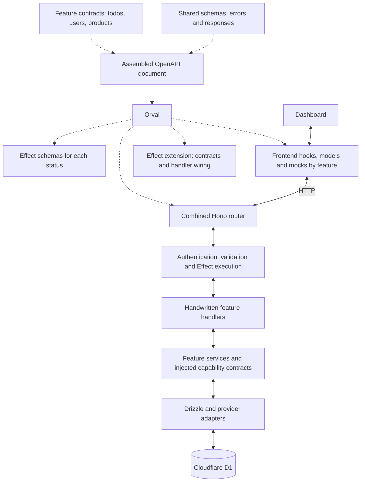

# OpenAPI → Orval → Hono + Effect

Every application endpoint uses this architecture end to end. Each feature owns a small OpenAPI fragment. Orval resolves their standard `$ref` links into one valid OpenAPI document and produces routes, Effect schemas and handler contracts, frontend query/mutation hooks, and MSW mocks.

The authoritative spec lives in `packages/contracts/openapi/api.json`, shared by the backend and frontend through the workspace contracts package. It is not inferred from Hono routes or frontend types. All four targets in `orval.config.ts` read this same entry point.

| Generated from OpenAPI                                                    | Implemented by hand                                             |
| ------------------------------------------------------------------------- | --------------------------------------------------------------- |
| Hono routes and operation wiring                                          | Worker entry point, bindings and shared middleware              |
| Effect schemas, inputs and typed success/failure unions                   | Business rules, permissions, queries and provider calls         |
| Missing handler entry points, preserved after creation                    | Handler implementations using `Effect.gen` and request services |
| Frontend HTTP functions, TanStack Query hooks, models and dashboard mocks | Pages and UI interactions consuming those hooks                 |

A new endpoint starts with a spec change and `pnpm api:generate`, followed by implementing the scaffolded handler. OpenAPI describes the HTTP contract; it cannot infer business behaviour or database migrations. Effect schemas and handler types are generated; request service classes and application services are handwritten. This is the same generation foundation used by Astumi, whose internal-operation filtering and provider-specific boundaries are application extensions.



Dotted arrows represent generation. Solid arrows represent runtime calls. The Worker mounts the generated router once; there is no handwritten application path dispatcher.

## Contract ownership

```text
packages/contracts/openapi/
  api.json                  API metadata, session security and explicit path references
  shared/
    errors.json             Reusable error schemas and HTTP responses
  features/
    todos.json              All todo routes and domain schemas
```

Add `users.json`, `products.json`, or another plural feature name under `features/`. Keep related operations in that feature's file. Larger features can be split when there is a real domain boundary. Shared definitions belong in `shared/`. Register paths explicitly in `api.json`; Orval resolves referenced files without a directory scanner.

Feature files contain `paths` and `components`. A local reference such as `#/components/schemas/Todo` resolves within its own file. Shared responses use relative references such as `../shared/errors.json#/components/responses/Unauthorized`. Choose descriptive PascalCase component names; Orval normalizes the referenced documents into one API.

The root path index uses standard JSON Pointer escaping (`~1` for `/`):

```json
{
	"paths": {
		"/api/todos": { "$ref": "./features/todos.json#/paths/~1api~1todos" },
		"/api/todos/{id}": { "$ref": "./features/todos.json#/paths/~1api~1todos~1{id}" }
	}
}
```

Add one reference per path, including new paths in an existing feature. Adding another method to an already referenced path needs no new root reference. Keep these references repository-local; the parser's external-reference permission allows Orval to load the feature and shared files.

Each operation has a globally unique camelCase `operationId` and one lowercase kebab-case tag matching its feature filename. For example, `getProduct` in `products.json` uses `tags: ["products"]`.

## Adding routes

1. Add operations to an existing feature file, or create another file in `openapi/features/`. Define public inputs, success responses, and typed error responses there. Use the reusable responses in `shared/errors.json` for boundary errors.
2. Reference new paths from `api.json`, then run `pnpm api:generate` (the native Orval CLI). No router imports or handwritten handler registry changes are needed.
3. Implement the new entry points created under `apps/api/src/features/<feature>/<operation-in-kebab-case>.ts`. Each is annotated with its generated Effect handler type. Regeneration never overwrites existing entry points, even when an operation is removed.
4. Use the generated frontend hooks and functions in `apps/dashboard/src/generated/<feature>.ts`. Marketing generates a fetch client for the waitlist; extend its input filter when it needs another feature.
5. Run `pnpm check`. The unresolved `TODO_IMPLEMENT_OPERATION` expression makes unfinished stubs fail ordinary TypeScript checking. Regenerate after contract changes and review changed or untracked output before committing. Naming conventions above are authoring conventions; there is no separate custom naming/collision scanner.

For example, adding `getProduct` to `features/products.json` creates:

```text
apps/api/src/features/products/get-product.ts         Handwritten implementation entry point
apps/api/src/generated/products.handlers.ts           Generated adapter wiring
packages/contracts/src/generated/products.effect.ts  Generated runtime schemas
apps/dashboard/src/generated/products.ts              Generated calls and query hooks
apps/dashboard/src/generated/products/products.msw.ts Generated mocks
```

The central `apps/api/src/generated/routes.ts`, `packages/contracts/src/generated/operations.ts`, and frontend `api.schemas.ts` update automatically. `packages/contracts/src/generated/openapi.json` is the complete Orval-normalised document for documentation and external tooling; edit the source fragments rather than this generated bundle.

Removing an operation removes its generated wiring and preserves the old implementation for review; remove obsolete implementation files when their generated types are no longer available.

One operation gets one implementation file. Put shared queries and services beside those files when useful. Todos share an application service and an owned repository; see the application service recipe below.

## Start with these files

| File                                             | Purpose                                                                                   |
| ------------------------------------------------ | ----------------------------------------------------------------------------------------- |
| `packages/contracts/openapi/features/todos.json` | Example feature contract.                                                                 |
| `packages/contracts/openapi/shared/errors.json`  | Shared error schemas and reusable responses.                                              |
| `orval.config.ts`                                | Configures all features together using Orval's tag-based grouping.                        |
| `codegen/effect-handlers.ts`                     | Extends native Effect generation with contracts, wiring and missing handler stubs.        |
| `packages/contracts/src/generated/operations.ts` | Generated registry re-exporting feature inputs, success/failure unions and handler types. |
| `apps/api/src/features/todos/get-todo.ts`        | Example typed Effect handler with an owned-record lookup.                                 |
| `apps/api/src/contract/handler.ts`               | Shared authentication, bounded JSON parsing, input validation, and Effect execution.      |
| `packages/contracts/src/http.ts`                 | Validates response status/body pairs on both sides.                                       |
| `apps/dashboard/src/generated/todos.ts`          | Generated HTTP functions and TanStack Query hooks.                                        |
| `apps/dashboard/src/generated/api.schemas.ts`    | Shared generated frontend models.                                                         |
| `packages/contracts/src/client.ts`               | Shared response validation, typed errors, binary decoding and network errors.             |
| `apps/dashboard/src/lib/contract-fetch.ts`       | Observed fetch and session redirects for generated dashboard calls.                       |

## Typed handlers and errors

`GetTodoHandler<ApiRequest>` is generated as an operation returning `Effect<GetTodoSuccess, GetTodoFailure, ApiRequest>`. The failure union pairs each declared HTTP status with its corresponding body. A 404 carries the `todo_not_found` body; a forbidden body cannot accidentally be used for that status.

Response interfaces and status/body unions are generated. Application services use tagged domain errors; HTTP handlers translate them into the declared failure union. Business logic decides when an error applies. Drizzle owns storage and migrations; queries explicitly select public fields and must satisfy the generated API types.

Expected failures become their declared HTTP response. Infrastructure failures and unexpected defects reach the existing reporting boundary and become a sanitized, contract-validated 500. The frontend validates the same schemas; generated query and mutation errors distinguish typed `ApiError<OperationResponseError>`, `TransportError`, and `ContractViolation`. `ApiError.response` retains the discriminated status/data pair.

## Generation and verification

`orval.config.ts` uses native multi-file input and Orval's custom client and `extraFiles` extension points. Native Effect generation emits schemas; the extension adds operation contracts beside them and re-exports them through the operation registry. Native Hono generation owns the combined routes file. A post-write hook removes unused duplicate TypeScript models from the Effect output. No separate OpenAPI parser or second route generator is maintained.

All `src/generated/` directories are owned by generation. Orval cleans those specific directories and writes formatted output directly. Handwritten feature directories are outside the clean targets. If generation fails, correct the contract and rerun it; output is not staged atomically. Review Git status for tracked changes and new files after generation, including missing handler entry points.

Tests exercise a temporary second products feature, native shared references, router/type/client/mock generation, preserved implementations, TypeScript rejection of unfinished handlers, unsupported boundary rejection, and removal of stale generated outputs. Separate local contract tests and Worker integration tests cover response validation, authentication, CSRF, ownership, malformed requests, and real database behaviour. Mocks are development helpers rather than independent evidence of correct behaviour.

`pnpm test:unit` also regenerates in a temporary workspace, compares every generated file against the checked-in output, and regenerates again to check byte-for-byte stability. This runs in CI and in `pnpm check`; stale, missing or extra generated files fail verification without rewriting the checkout. Run `pnpm api:generate` after changing the spec, generator or Orval version and include the resulting output.

## Supported transports and security

All application routes are defined in OpenAPI: todos, storefront, account/config/health, keys, billing, checkout, waitlist, email, API-key todos/summary, files and the Stripe webhook. `packages/contracts/src/index.ts` only exposes aliases of generated types; it has no parallel Zod inputs, endpoint registry or database-derived public DTOs.

- Cookie sessions are the default. Their Effect request service carries the verified user, request, bindings and product client. Mutations require a trusted Origin.
- `security: []` declares public operations. Storefront mutations require a trusted Origin. Waitlist explicitly sets `x-require-origin: false` for server callers; a supplied untrusted Origin is still rejected by the outer boundary.
- `security: [{ "apiKey": [] }]` with `x-api-key-scope` selects the API-key adapter. It verifies the bearer key and scope, applies rate limiting and preserves quota headers. These requests do not require a browser Origin.
- Stripe security selects the signed-webhook protocol. `x-raw-body: true` preserves the raw text for signature verification before event parsing; `x-max-body-bytes: 262144` bounds the read. The handler uses Stripe's signature verifier and the existing atomic reconciliation logic. It does not accept a browser session in place of a signature.

Path parameters, scalar query parameters and declared headers are validated with generated Effect schemas. Numeric/boolean query values are converted before validation; repeated or unknown query keys are rejected on query-bearing operations. Optional bodies, cookie parameters, non-scalar query parameters and unsupported media types fail generation. Every operation declares boundary errors; domain errors such as 402, 409, 429 and 502 are declared where used. Application service errors are mapped in HTTP entry handlers using the generated status/body schema. HttpError remains confined to HTTP/auth protocol boundaries. Unexpected defects reach sanitized reporting.

JSON bodies default to 16 KiB. File uploads use `application/octet-stream`, a bounded 5 MiB read and a generated File input schema; the supplied content type is preserved as object metadata. Downloads stream the R2 body without buffering it on the Worker. Generated browser calls return a Blob. Response headers preserve ETag, length and disposition. HEAD returns only metadata, including bodyless errors. The extension adapts Orval's HEAD registration to Hono's `.on` API and routes Hono's implicit GET dispatch to the generated HEAD handler. Bodyless 204 responses are validated too.

Better Auth is the sole provider-owned HTTP mount at `/api/auth/*`. It retains its native OAuth callbacks, redirects, cookie handling, session response and sign-in/out protocol. Inventing an application JSON contract for those responses would discard provider semantics. Account data at `/api/me` is a generated application operation. The outer Worker retains proxy verification, CORS, maintenance checks and telemetry.

Orval's native Effect output does not generate application handler signatures, preserve `minProperties`, or provide the required binary/HEAD boundary. The extension supplies those pieces through its custom client and `extraFiles` hooks. Business logic and D1 migrations remain handwritten. Zod is used only in local tooling/fixtures, not application API contracts.

## Application services and boundaries

Todos demonstrate the backend dependency direction without requiring a Worker in unit tests:

- `features/todos/domain.ts` owns validated title construction and a nonempty change union. The generated OpenAPI value schemas are exposed through `@workspace/contracts/todos`; neither application policy nor persistence repeats title limits. Internal calls are validated too.
- `features/todos/service.ts` declares TodoService, the user-scoped TodoRepository dependency and the missing-record error. Repository input types only permit validated titles and nonempty changes. There is no HTTP status or database client in either interface.
- `features/todos/live.ts` supplies policy: normalisation, invalid-change rejection and missing-record handling. It depends on the repository contract, not Drizzle. The layer is the same in production and tests.
- `features/todos/repository.ts` implements that contract with Drizzle. Every operation is scoped to the trusted owner, selects explicit public columns and decodes results. D1 failures and invalid stored data become StorageError; they cannot become a successful empty list or a missing-record error.
- `runtime/user-layers.ts` composes the live layer with the concrete, request-scoped repository. Session and API-key entry handlers both use it, so ordering, limits and ownership have one implementation. No global runtime retains a previous request's user or bindings.
- Operation handlers own generated response types and HTTP error translation. Shared error mappings stay in `http-errors.ts`. Storage failures reach the sanitized reporting boundary; mixed failure/defect/interruption causes cannot be recovered as ordinary responses.

Use Effect.gen for workflows, Effect.tryPromise for external promise adapters and Effect.runPromise only where the host executes an Effect. Use Effect Clock for workflow instants and forward interruption to cancellable providers. D1 statements cannot be aborted: `storageEffect` waits for their settlement before interruption cleanup. Do not claim a request cancellation rolled back a write.

A new feature does not need every file. A direct status query can stay in its handler; introduce a service when there is shared policy or an implementation boundary. A service with five forwarding methods and no such role is not an architectural improvement. Keep related code together until its responsibilities justify a split.

### Feature ownership

| Feature              | Policy                                                                                                 | Infrastructure boundary                                                                |
| -------------------- | ------------------------------------------------------------------------------------------------------ | -------------------------------------------------------------------------------------- |
| Checkout             | Server-owned offer, order ownership, canonical reconciliation and webhook policy                       | Shared PaymentGateway; atomic order/grant/balance repository                           |
| Billing and metering | Credit cost, input conflict/replay, validated snapshot before debit                                    | Billing D1 transaction and owned product aggregates; stored replay decoding            |
| Storefront           | Product selection, buyer proof, test-only sessions and rate limits                                     | Shared PaymentGateway; explicit unavailable failures for invalid/missing provider data |
| Email and waitlist   | Verified recipients, consent, sequential hashed limits, deduplication and optional confirmation policy | Native email adapter; claimed delivery repository; unique waitlist inserts             |
| Keys                 | Scoped authentication, issuance limits, ownership and revocation                                       | Identity crypto and D1 adapters; atomic key limit/insertion                            |
| Files                | Owned key validation and storage capability                                                            | R2 adapter normalizes metadata/streams; one HTTP header encoder                        |
| Rate limits          | Fixed-window policy and injected Effect Clock                                                          | Atomic identity D1 counter; quota headers only at HTTP boundaries                      |

Runtime factories supply configuration, trusted identities, database bindings and concrete provider Layers per request. Application services import capability contracts, never another feature's repository/provider. Small direct capabilities such as FileStore need no forwarding service. System health/configuration and Better Auth remain host concerns. API-key authentication has a separate capability and lookup repository; it never constructs owner-bound key management with a placeholder identity.

PaymentGateway owns Stripe request translation, signature verification and response decoding. Checkout intents distinguish credit orders from guest purchases; stable idempotency keys retain their original formats. Calls forward Effect cancellation to fetch and disable automatic network retries. Canonical retrieval, amount/currency/owner checks and atomic immutable grants protect reconciliation. SDK/data decoding never substitutes a successful zero amount or currency when provider data is missing.

Email state is a validated union: accepted requires a receipt, failed requires a failure code, and sending has neither. Native email sending cannot be aborted, so claim acquisition, delivery and settlement finish before interruption cleanup. An ambiguous or previously failed attempt is not automatically resent. Optional waitlist confirmations recover only expected delivery/configuration/conflict failures; storage errors and fatal causes still reach sanitized reporting.

Public types and value schemas derive from OpenAPI through the contracts package. Storage adapters select explicit fields and decode rows. Summary aggregate invariants are checked before the ledger call, with a separate decode for stored replay. D1 schema constraints remain a separate persistence safeguard; they do not replace trust-boundary decoding. No database migration is needed for these architecture changes.

### Enforcement and verification

Oxlint rejects explicit any, non-null assertions, unused backend bindings and unsafe application imports/APIs. The architecture check uses the pinned TypeScript 7 compiler API to inspect the dependency graph and actual D1 receiver types. It detects cycles, cross-feature private imports, transitive application-to-adapter dependencies, hidden node/effect subpath imports, unchecked assertions and suppression comments. Only the validated generic HTTP status/body correlation in contract/service.ts needs a type assertion. Direct D1 prepare/exec/batch and destructured equivalents are rejected; Drizzle batches and RegExp.exec are allowed.

HTTP entry points are discovered from generated wiring; other feature files default to application code. Infrastructure roles are explicit. Application code cannot use async functions, ambient time/I/O or nested Effect execution, even under an unfamiliar filename. Review any new infrastructure role or public export; static checks cannot prove that a module is cohesive or an abstraction is worthwhile.

Unit tests provide fake dependency Layers to the production live layers, including an Effect test clock. They cover domain validation, state invariants, no resend on replay, optional-error classification, fatal causes, billing conflict/replay and validation before charging. Architecture fixtures test rejection and legitimate adapter cases. Real local Worker tests cover D1/R2 ownership, CSRF, rate limiting, debit/grant races, webhook authenticity/reordering, missing provider data, malformed stored data and sanitized reporting.

Run pnpm check before committing. CI runs lint, unit/generation checks, types and builds; Worker integration tests remain local. When upgrading the pinned compiler, run the architecture fixtures alongside the full suite because its compiler API is version-specific. Better Auth and native SDK protocols remain deliberate integration boundaries, not alternative application service patterns.
