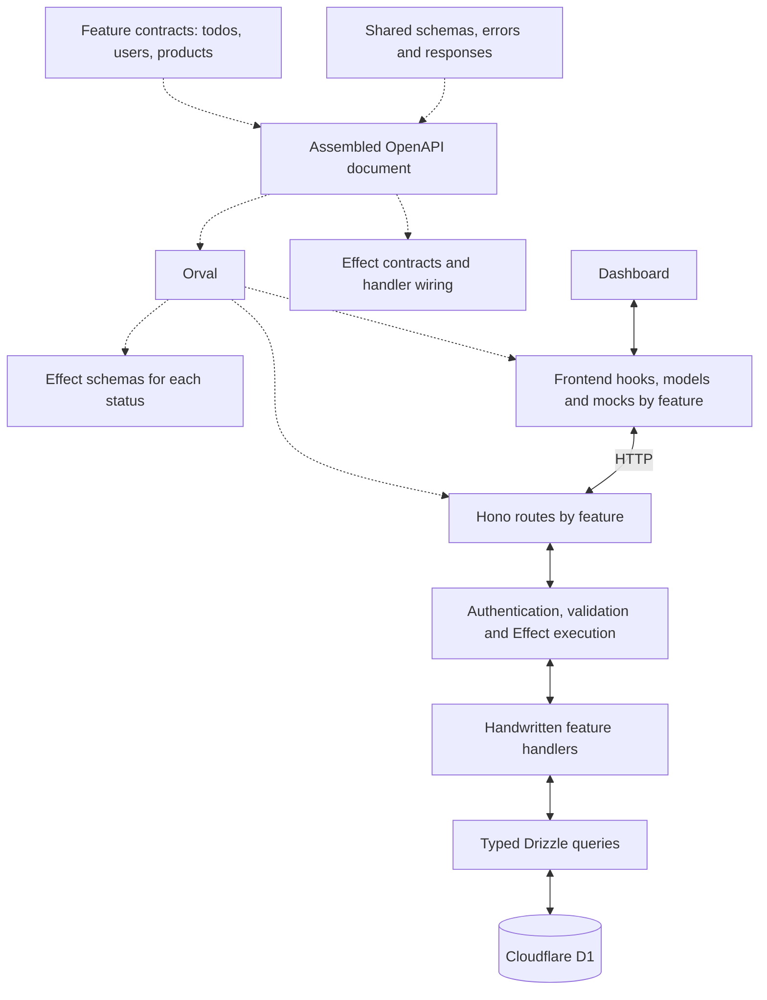

# OpenAPI → Orval → Hono + Effect

The todo feature uses this architecture end to end. Each feature owns a small OpenAPI fragment. Generation assembles them into one valid OpenAPI document and produces routes, Effect schemas and handler contracts, frontend query/mutation hooks, and MSW mocks.



Dotted arrows represent generation. Solid arrows represent runtime calls. Users and products illustrate future feature modules; only todos is currently migrated.

## Contract ownership

```text
packages/contracts/openapi/
  api.json                  API metadata and default session security
  shared/
    errors.json             Reusable error schemas and HTTP responses
  features/
    todos.json              All todo routes and domain schemas
```

Add `users.json`, `products.json`, or another plural feature name under `features/`. Keep related operations in that feature's file. Larger features can be split when there is a real domain boundary. Shared definitions belong in `shared/`; generation discovers both directories automatically, in a stable order.

Fragments contain `paths` and/or `components`. They use ordinary local references such as `#/components/schemas/Todo` and `#/components/responses/Unauthorized`, resolved against the assembled document. Components share one namespace, so choose descriptive PascalCase names. Shared error definitions are authored once and referenced by operations.

Each operation has a globally unique camelCase `operationId` and exactly one lowercase kebab-case tag matching its feature filename. For example, `getProduct` in `products.json` uses `tags: ["products"]`.

## Adding routes

1. Add operations to an existing feature file, or create another file in `openapi/features/`. Define public inputs, success responses, and typed error responses there. Use the reusable responses in `shared/errors.json` for boundary errors.
2. Run `pnpm api:generate`. No Orval configuration, router imports, or handwritten handler registry changes are needed.
3. Implement the new entry points created under `apps/api/src/features/<feature>/<operation-in-kebab-case>.ts`. Each is annotated with its generated Effect handler type. Regeneration never overwrites existing entry points, even when an operation is removed.
4. Use the generated frontend hooks and functions in `apps/dashboard/src/generated/<feature>.ts`.
5. Run `pnpm check`. CI rejects duplicate paths, schema names or operation IDs, mismatched feature tags, stale output, and unfinished handler stubs. Replace the scaffold's implementation and remove its `TODO_IMPLEMENT_OPERATION` marker when it is ready.

For example, adding `getProduct` to `features/products.json` creates:

```text
apps/api/src/features/products/get-product.ts         Handwritten implementation entry point
apps/api/src/generated/products.ts                    Generated Hono router
apps/api/src/generated/products.handlers.ts           Generated adapter wiring
packages/contracts/src/generated/products.effect.ts  Generated runtime schemas
apps/dashboard/src/generated/products.ts              Generated calls and query hooks
apps/dashboard/src/generated/products/products.msw.ts Generated mocks
```

The central `apps/api/src/generated/routes.ts`, `packages/contracts/src/generated/operations.ts`, and frontend `api.schemas.ts` update automatically. `packages/contracts/src/generated/openapi.json` is the complete document for documentation and external tooling; edit the source fragments rather than this generated bundle.

Removing an operation removes its generated wiring and preserves the old implementation for review; remove obsolete implementation files when their generated types are no longer available.

One operation gets one implementation file. Put shared queries and services beside those files when useful. Todos currently share database projection/query helpers in `apps/api/src/features/todos/repository.ts`.

## Start with these files

| File                                             | Purpose                                                                              |
| ------------------------------------------------ | ------------------------------------------------------------------------------------ |
| `packages/contracts/openapi/features/todos.json` | Example feature contract.                                                            |
| `packages/contracts/openapi/shared/errors.json`  | Shared error schemas and reusable responses.                                         |
| `orval.config.ts`                                | Configures all features together using Orval's tag-based grouping.                   |
| `scripts/api-contract.ts`                        | Discovers and assembles modules; checks ownership and naming.                        |
| `scripts/generate-api.ts`                        | Generates Effect signatures and wiring; creates missing entry points once.           |
| `packages/contracts/src/generated/operations.ts` | Generated inputs, success/failure unions, and handler types.                         |
| `apps/api/src/features/todos/get-todo.ts`        | Example typed Effect handler with an owned-record lookup.                            |
| `apps/api/src/contract/handler.ts`               | Shared authentication, bounded JSON parsing, input validation, and Effect execution. |
| `packages/contracts/src/http.ts`                 | Validates response status/body pairs on both sides.                                  |
| `apps/dashboard/src/generated/todos.ts`          | Generated HTTP functions and TanStack Query hooks.                                   |
| `apps/dashboard/src/generated/api.schemas.ts`    | Shared generated frontend models.                                                    |
| `apps/dashboard/src/lib/contract-fetch.ts`       | Response validation, typed errors, network errors, and session redirects.            |

## Typed handlers and errors

`GetTodoHandler<ApiRequest>` is generated as an operation returning `Effect<GetTodoSuccess, GetTodoFailure, ApiRequest>`. The failure union pairs each declared HTTP status with its corresponding body. A 404 carries the `todo_not_found` body; a forbidden body cannot accidentally be used for that status.

There are no handwritten response interfaces, error classes, or status mappings per operation. Business logic still decides when an error applies. Drizzle owns storage and migrations; queries explicitly select public fields and must satisfy the generated API types.

Expected failures become their declared HTTP response. Infrastructure failures and unexpected defects reach the existing reporting boundary and become a sanitized, contract-validated 500. The frontend validates the same schemas; generated query and mutation errors distinguish typed `ApiError<OperationResponseError>`, `TransportError`, and `ContractViolation`. `ApiError.response` retains the discriminated status/data pair.

## Generation and verification

All `src/generated/` directories are owned by generation. Generation completes in staging, then updates changed files and removes stale generated outputs. Handwritten files are preserved. `pnpm api:check` compares staged output without touching project files or creating implementation stubs.

Tests exercise a temporary second products feature, shared response references, automatic router/type/client/mock generation, preserved implementations, stub rejection, collisions, and removal of stale generated outputs. Separate contract tests and Worker/browser integration tests cover response validation, authentication, CSRF, ownership, malformed requests, and real database behaviour. Mocks are development helpers rather than independent evidence of correct behaviour.

## Deliberate boundaries

All five todo operations are migrated. Better Auth, billing/Stripe, files, keys, waitlist, and email retain their existing contracts and handlers. The free API-key todo endpoint reuses the typed query.

The current adapter supports explicit 2xx/4xx/5xx statuses, required JSON request bodies, JSON responses, path parameters, cookie-session security, and bodyless 204 responses. Shared response/schema references are supported. Unsupported parameter locations, optional bodies, and media types are rejected. Every operation declares 400/401/403/500/503 responses, plus 413/415 when it accepts a body. Cookie-session security defaults come from `api.json`.

Orval does not generate Effect handler signatures or preserve `minProperties` in its Effect output. The companion supplies those pieces. The shared Effect boundary replaces Hono's stock response validators and covers every declared status. Effect 4 is used here; Zod remains for the integrations that have not migrated.
