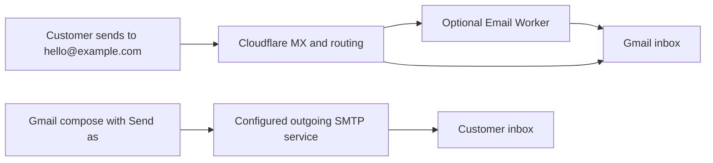

# Custom-domain email: Cloudflare, Gmail and replacement options

Researched 27 October 2026. This is an architecture assessment based on official documentation, not an inspection of the existing domain or Gmail settings. No account, DNS or application configuration was changed.

## Finding

Google now explicitly says third-party Gmail “Send as” ends in January 2027. This is separate from its removal of Gmailify and incoming POP fetching. Forwarded messages can still arrive in Gmail; Google-hosted Gmail and Workspace identities are exempt. Changing only the outgoing SMTP provider inside Gmail does not avoid removal of the Gmail feature.

Sources: [Google's transition announcement](https://support.google.com/mail/answer/17101213?hl=en), [Send as documentation](https://support.google.com/mail/answer/22370?hl=en), [POP and Gmailify changes](https://support.google.com/mail/answer/16604719?hl=en).

## How the existing arrangement probably works

1. You register and renew a domain. The domain name and email hosting are separate purchases; free forwarding does not make domain registration free.
2. Its MX DNS records direct incoming mail to Cloudflare.
3. An Email Routing rule maps an address such as `hello@example.com` to a verified Gmail destination. Several addresses can feed the same inbox. Those addresses are aliases, not separate mailboxes or user accounts.
4. Optionally, an Email Worker runs code to filter, process, forward or respond to messages. Plain forwarding does not require a Worker.
5. Gmail stores the forwarded messages and provides the inbox interface.
6. Gmail “Send mail as” configures a separate outgoing identity and SMTP connection. Verifying the alias proves you can receive at it; the SMTP service actually submits outbound mail.

A Cloudflare Worker URL is not normally an SMTP server. The precise existing outbound service cannot be identified from the description alone: it could be Google SMTP, a relay, or another configured integration. Check the hostname under Gmail Settings → Accounts and Import → Send mail as → Edit info. Do not share passwords or app passwords. An original sent-message header can also reveal the signing domain, return path and authentication results.

Sources: [Cloudflare routing setup](https://developers.cloudflare.com/email-service/get-started/route-emails/), [Google Send as setup](https://support.google.com/mail/answer/22370?hl=en).

## What makes the address suitable for business

An address on your domain is only part of the requirement. Incoming routing, authenticated outgoing delivery, inbox storage, sent-message history and an appropriate interface must all work together. A collection of aliases into one person's inbox does not provide separate staff accounts, delegated access or shared-mailbox administration.

SPF authorizes servers for the envelope sender domain. DKIM signs messages with a domain identity. DMARC connects authentication to the visible From domain: an aligned SPF or DKIM pass can satisfy DMARC. A successful send call or an editable From field alone proves neither authentication nor inbox placement. Check received message headers and test replies, attachments and spam placement before migrating.

Sources: [Cloudflare authentication](https://developers.cloudflare.com/email-service/concepts/email-authentication/), [DMARC identifier alignment](https://datatracker.ietf.org/doc/html/rfc7489#section-3.1), [Cloudflare deliverability](https://developers.cloudflare.com/email-service/concepts/deliverability/).

## Keeping the existing inbox with a different client

A promising architecture is Cloudflare forwarding → Gmail storage, with Thunderbird reading Gmail through IMAP and sending the custom-domain identity through an independent SMTP relay. Thunderbird supports multiple identities, per-identity outgoing servers and configurable sent-message folders. Configure the domain identity to store sent copies in the intended Gmail folder, then test synchronization and reply identity selection.

This is an architecture recommendation, not an end-to-end verified setup for this account. Google explicitly continues external-client access to Gmail. The outgoing SMTP connection must use a service that accepts and authenticates the custom domain; changing a display address alone is insufficient.

Sources: [Thunderbird identities](https://support.mozilla.org/en-US/kb/using-identities), [per-identity settings](https://support.mozilla.org/en-US/kb/configuration-options-identity), [Google transition announcement](https://support.google.com/mail/answer/17101213?hl=en).

## Migration approach

1. Identify the current domain aliases, number of independent users, outgoing SMTP hostname and approximate monthly sending volume.
2. Decide whether a desktop client is acceptable or browser-based mail is essential.
3. For an external-client route, retain inbound forwarding and test one authenticated outbound identity. For hosted webmail, first establish account eligibility and verify the domain before changing MX records.
4. Test new outbound messages, replies, attachments, sent-mail synchronization and SPF/DKIM/DMARC results using independent recipient accounts.
5. Move regular use before January 2027. Retain the existing mailbox history and document the rollback settings.

Do not treat transactional application email as interchangeable with staff mailboxes. The repository's existing Email Sending integration is for application messages; a human mailbox needs an interface, history and account management too.

## Provider comparison

## SMTP2GO + existing Cloudflare inbound routing + external mail client

- SMTP2GO free: 1,000 emails/month, 200/day, max 5 sender domains or single sender addresses; 25/hour restriction if no sender domain is verified. Reports retained 5 days; ticket-only support after 14 days. This is an outbound relay, not a mailbox.
- Homepage explicitly supports general emails from Outlook, alongside transactional and marketing messages. Therefore appropriate in principle for ordinary person-to-person correspondence, not merely app notifications.
- Signup requires an email on a private domain (not gmail.com) and phone verification. Existing Cloudflare forwarded domain address can receive the signup email.
- Official Gmail guide currently exists, but its Gmail Send as recipe will not solve the January 2027 change. Inference/recommendation: keep inbound forwarding into Gmail, read Gmail via an OAuth-capable external client, configure the business identity to use SMTP2GO outbound. Verify client identity selection and sent-folder behavior in a pilot.
- Sources: [Free plan](https://support.smtp2go.com/hc/en-gb/articles/223087947-Free-Plan), [supported use cases and signup](https://www.smtp2go.com/), [current Gmail guide](https://www.smtp2go.com/setupguide/gmail/).

## Zoho free custom-domain mailbox

- Official pricing advertises one domain, up to 5 users, 5 GB mailbox storage each; IMAP, POP, ActiveSync excluded; available only in select data centers.
- UK signup availability could NOT be confirmed from primary sources. Do not promise UK eligibility. Confirm actual offered plan before migrating DNS.
- Reasonable free complete-mailbox candidate if eligible and comfortable with Zoho web/mobile interface. Inbound MX would point to Zoho rather than ordinary Cloudflare forwarding for the domain.
- Do not confidently claim SMTP is unavailable: official SMTP help explicitly lists Free Organization users with smtp.zoho.com, but availability can depend on account/datacenter. Since receiving via IMAP is excluded, this does not make the free plan equivalent to a full standard-client mailbox.
- Sources: [pricing](https://www.zoho.com/mail/zohomail-pricing.html), [SMTP settings](https://www.zoho.com/mail/help/zoho-smtp.html).

## Cloudflare Email Sending — important current change

- Current official docs now expose authenticated SMTP, not only Workers binding/REST API. SMTP reference updated 15 October 2026.
- Host smtp.mx.cloudflare.net, port 465 implicit TLS only; username api_token; password Cloudflare API token with Email Sending: Edit. No 587 STARTTLS or outbound 25. Sender domain must be onboarded.
- SMTP has a 5 MiB total message limit (including encoded attachments) and 50 recipients/session. These are meaningful limits for general business correspondence.
- Outbound arbitrary recipients requires Workers Paid. Includes 3,000/month then $0.35/1,000. Sending to preverified destination addresses is free on all plans and excluded from the quota; this is not free general outbound mail.
- Current overview still describes Email Sending as Beta and transactional. Do not automatically position it as an unrestricted hosted business mailbox; no mailbox/webmail is supplied. General mail-client support is documented, but ordinary human correspondence usage policy was not conclusively resolved.
- Sources: [SMTP reference](https://developers.cloudflare.com/email-service/api/send-emails/smtp/), [pricing](https://developers.cloudflare.com/email-service/platform/pricing/), [send guide](https://developers.cloudflare.com/email-service/get-started/send-emails/), [overview](https://developers.cloudflare.com/email-service/).

## Recommendation

For minimum subscription cost and retaining current Gmail storage: investigate Cloudflare inbound + SMTP2GO outbound + independent client. This is a composition of services, not a complete managed business mailbox. For a simple browser-based free mailbox: check Zoho free availability for the actual region/account. For business-critical simplicity/team administration, a modest paid mailbox is likely the better trade-off; paid-provider recommendations/prices should be checked separately.
